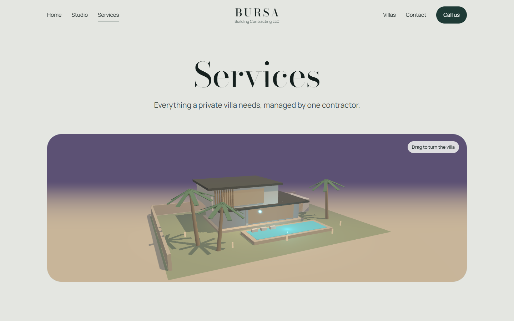
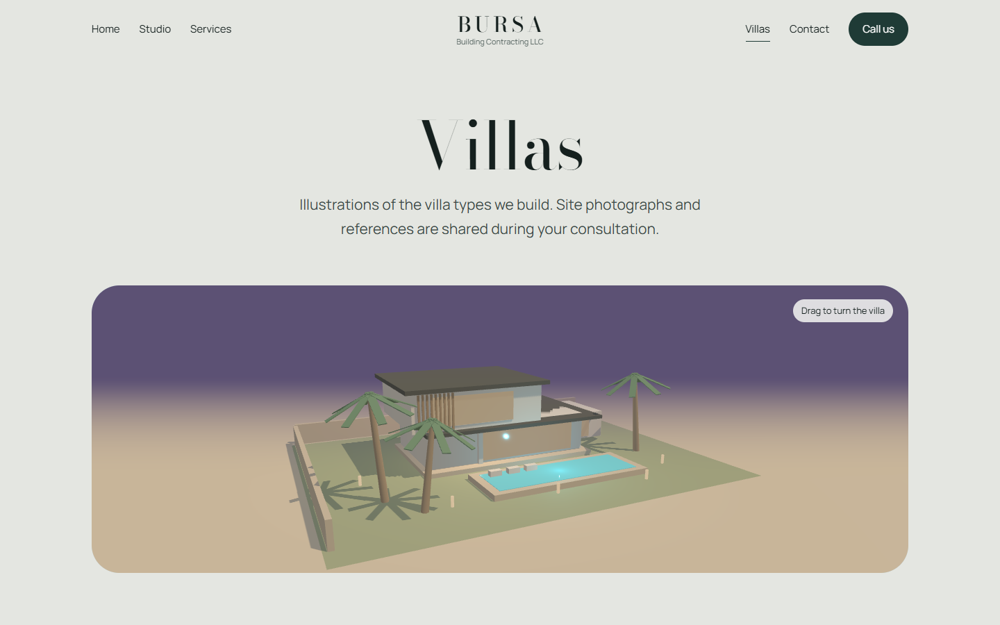
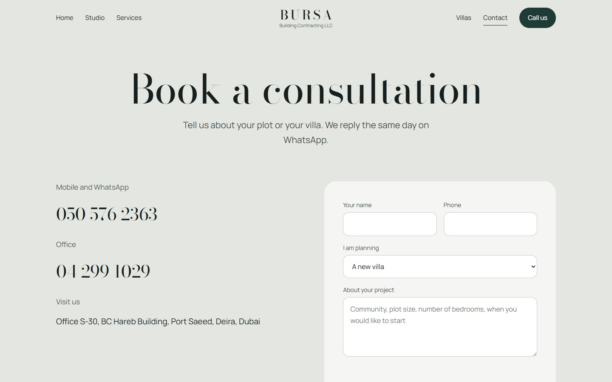
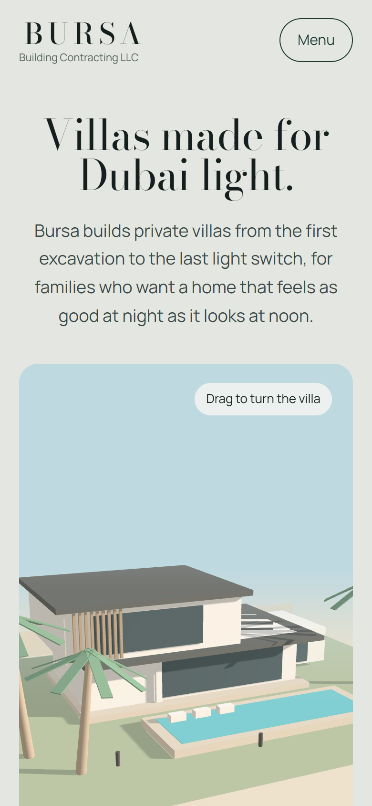

# Bursa Building Contracting Co LLC

A multi-page static concept website for **Bursa Building Contracting Co LLC**, a boutique villa construction and renovation contractor based in Port Saeed, Deira, Dubai.

Built around a warm architectural **limestone, deep teal, and dusk palette**, the site features an interactive **Three.js 3D modern villa** with a swimming pool and palm trees—complete with **drag-to-orbit camera controls** and a real-time **Time of Day slider** that transitions the sky, sun angle, shadows, and interior/pool lighting from midday to dusk and night.

---

## Screenshots

### Desktop — Interactive 3D Villa Hero (Time-of-Day Lighting)


### Pages & Responsive Views

| Services | Villas Showcase |
| :---: | :---: |
|  |  |

| Book a Consultation | Mobile Responsive (`390×844`) |
| :---: | :---: |
|  |  |

<details>
<summary>View Full Landing Page Screenshot</summary>


</details>

---

## Key Features

- **Interactive Three.js 3D Villa & Lighting System (`assets/js/scene.js`)**:
  - Powered by bundled **Three.js r128** (`assets/js/vendor/three.min.js`) with soft PCF shadow mapping (`PCFSoftShadowMap`).
  - **Time-of-Day Slider (`[data-tod]`)**: Smoothly interpolates sky color, fog, sun position/intensity, and warm interior/pool glow across **Midday → Dusk → Night**.
  - **Drag-to-Turn Controls**: Pointer drag rotates the villa stage smoothly; mini 3D scenes on inner pages render at golden hour and night presets.
  - Respects `prefers-reduced-motion`.
- **Room-by-Room Accordion (`<details>`)**: Native accessible disclosures covering Living & Majlis, Kitchen, Bedrooms & Baths, and Pool & Garden finishing scopes.
- **Architectural SVG Villa Illustrations**: Custom gradient vector illustrations depicting New Villa, Extension, Full Renovation, Courtyard Villa, Cantilever Villa, and Night Garden typologies.
- **WhatsApp Consultation Form (`assets/js/main.js`)**: Client-side validation for name, phone, and brief, launching a pre-filled WhatsApp message to `+971 50 576 2363`.
- **Zero Build Step**: Pure HTML5, CSS3, and vanilla JavaScript.

---

## Pages Included

| File | Page | Highlights |
| :--- | :--- | :--- |
| `index.html` | **Home** | Interactive 3D villa with time-of-day slider, three ways to build, room-by-room breakdown, studio quote |
| `about.html` | **Studio** | Port Saeed studio ethos, one-contact site engineer model, itemised pricing, 4-step client journey |
| `services.html` | **Services** | Villa construction, finishing works, extensions, renovation, pools & outdoors, MEP coordination |
| `projects.html` | **Villas** | Illustrated gallery of 6 villa typologies (Courtyard, Night Garden, Cantilever, Family Extension, Terrace, Renovated) |
| `contact.html` | **Book a consultation** | Port Saeed office details, WhatsApp form, embedded Google Map |
| `404.html` | **Not Found** | Custom editorial 404 page (`This room has not been built yet.`) |

---

## Design System & Typography

- **Fonts**: `Bodoni Moda` (editorial serif display headings) and `Manrope` (clean geometric sans body) via Google Fonts.
- **Color Tokens** (`assets/css/style.css`):
  - Limestone Background: `#E4E6E1`
  - Chalk Surface: `#F5F6F3`
  - Deep Teal: `#1F3B36` / `#2E5750`
  - Dusk Accent: `#8E7FA8`
  - Brass Highlight: `#A9844A`
  - Ink Text: `#15201E`

---

## Project Structure

```text
bursa-villas/
├── index.html
├── about.html
├── services.html
├── projects.html
├── contact.html
├── 404.html
├── favicon.svg
├── screenshots/
│   ├── home-hero.png
│   ├── home-full.png
│   ├── services.png
│   ├── projects.png
│   ├── contact.png
│   └── mobile-home.png
└── assets/
    ├── css/
    │   └── style.css
    └── js/
        ├── main.js
        ├── scene.js
        └── vendor/
            └── three.min.js
```

---

## Run Locally

No build step or dependencies needed:

```bash
git clone https://github.com/hassaankhalid225/bursa-villas.git
cd bursa-villas

# Using Node.js
npx serve .

# Or using Python
python -m http.server 8000
```

---

## Deployment

Ready for static hosting on **Vercel**, **Netlify**, or **GitHub Pages**:

1. Connect this repository in your deployment dashboard.
2. Leave the **Build Command** blank and set the **Output Directory** to `.`.
3. Deploy.

---

## Notes

- Contact details (`Office S-30, BC Hareb Building, Port Saeed, Deira, Dubai`, `050 576 2363`, `04 299 1029`) come from public business directory listings.
- Villa illustrations and project descriptions are sample concept content for design review.
