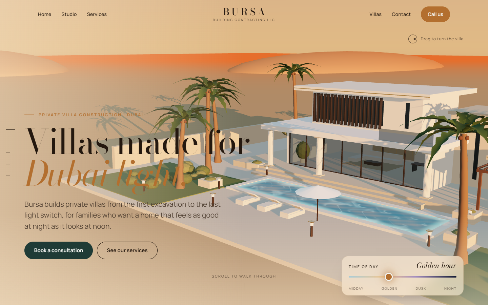
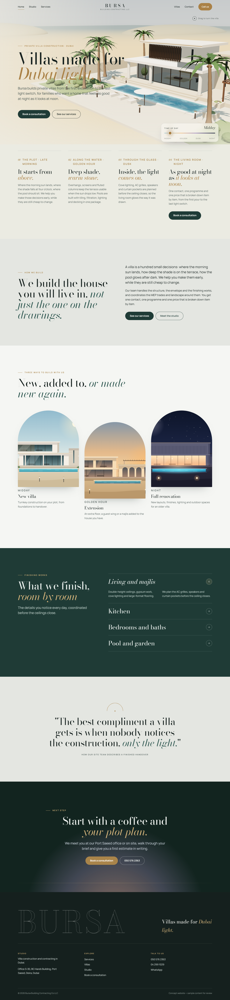

# Bursa Building Contracting Co LLC

A multi-page static concept website for **Bursa Building Contracting Co LLC**, a boutique villa construction and renovation contractor based in Port Saeed, Deira, Dubai.

Built around a warm architectural **limestone, deep teal, dusk lilac and brass** palette with an editorial **Bodoni Moda** serif, the home page is a single **scroll-driven 3D story**: a Three.js limestone villa with pool and palms that the camera approaches from the air, glides along the water, and enters through the glass while the day moves from midday to golden hour, dusk and night. A **Time of Day slider** lets visitors take over at any moment, and the whole page (header, panels, buttons, browser theme colour) re-tints with the light.

---

## Screenshots

### Desktop — Interactive 3D Villa Hero (Time-of-Day Lighting)


### Pages & Responsive Views

| Services | Villas Showcase |
| :---: | :---: |
|  |  |

| Book a Consultation | Mobile Responsive (`375×812`) |
| :---: | :---: |
|  |  |

<details>
<summary>View Full Landing Page Screenshot</summary>



</details>

---

## Key Features

- **Cinematic 3D villa (`assets/js/scene.js`, Three.js r128 vendored locally)**
  - Stepped limestone volumes, a deep cantilevered overhang on fluted columns, bronze fins, arched majlis windows, a pergola, a stair tower and a walk-in living room (sofa, feature stone wall, pendants, floating stair, cove lighting).
  - Shader sky with a sun that travels across the sky, a moon and stars; ACES tone mapping, image-based reflections on the glazing, soft PCF shadows.
  - Hand-written water shader: animated ripples, caustics, Fresnel sky reflection, sun glints, underwater glow and the warm house reflected at night.
  - Sculpted palms (ringed trunks, folded fronds that sway), olive trees, shrubs, lawns, lanterns and trunk uplights; additive glow sprites stand in for bloom so it stays fast.
  - Smooth inertial drag-to-rotate (horizontal only, so touch scrolling is never hijacked); rendering pauses off-screen and in hidden tabs; DPR capped (1.75 desktop, 1.4 mobile) with automatic resolution drop on slow devices; lighter scene on phones (fewer palms and details, no shadows).
- **Scroll story (`index.html` + `assets/js/main.js`)**: a pinned stage with five chapters (Approach, The plot, Golden hour, Dusk, Night). The camera follows a spline with eased dwell points, time of day advances with scroll, chapter text crossfades, and a chapter rail lets you jump between stops.
- **Time of Day slider (`[data-tod]`)**: keyboard-operable range input with a visible label and live `aria-valuetext` (Midday / Golden hour / Dusk / Night). It drives the 3D lighting and the page tint (CSS custom properties `--tod-*`).
- **Villas gallery (`projects.html`)**: six layered SVG architectural illustrations at different times of day with pointer and scroll parallax, swaying palms and pool shimmer on hover, and a per-villa **"Switch the lights on"** toggle that turns the scene to evening.
- **Brand loader**: a brass line draws the sun arc and villa silhouette (about 1 second, first page of a visit only, pure CSS so it can never block the page).
- **Soft page transitions**: CSS cross-document view transitions with a small JS fade fallback.
- **WhatsApp consultation form (`assets/js/main.js`)**: client-side validation for name, phone and brief, opening a pre-filled WhatsApp message to `+971 50 576 2363`.
- **Accessible and robust**: `prefers-reduced-motion` turns off the scroll camera, loader and animations (static frame, slider still works); visible focus states; a layered SVG fallback replaces the canvas when WebGL is unavailable and still follows the slider.
- **Zero build step**: plain HTML, CSS and vanilla JavaScript.

---

## Pages Included

| File | Page | Highlights |
| :--- | :--- | :--- |
| `index.html` | **Home** | Scroll-driven 3D villa story with time-of-day slider, three ways to build, room-by-room breakdown, studio quote |
| `about.html` | **Studio** | Arched 3D villa at golden hour, one-contact site engineer model, itemised pricing, 4-step client journey timeline |
| `services.html` | **Services** | Wide 3D villa at dusk, illustrated index of villa construction, finishing, extensions, renovation, pools & outdoors, MEP coordination |
| `projects.html` | **Villas** | Parallax gallery of 6 illustrated villa types with a lights-on toggle (Courtyard, Night Garden, Cantilever, Family Extension, Terrace, Renovated) |
| `contact.html` | **Book a consultation** | Port Saeed office details, WhatsApp form, embedded Google Map |
| `404.html` | **Not Found** | Custom editorial 404 page (`This room has not been built yet.`) |

---

## Design System & Typography

- **Fonts**: `Bodoni Moda` (editorial serif display headings, with italic accents) and `Manrope` (clean geometric sans body) via Google Fonts.
- **Color Tokens** (`assets/css/style.css`):
  - Limestone Background: `#E4E6E1`
  - Chalk Surface: `#F5F6F3`
  - Deep Teal: `#1F3B36` / `#2E5750`
  - Dusk Accent: `#8E7FA8`
  - Brass Highlight: `#A9844A`
  - Deep Night Teal: `#12241F`
  - Time-of-day tints: `--tod-sky`, `--tod-hz`, `--tod-accent`, `--tod-ink`, `--tod-panel` (set live by `main.js`)
  - Ink Text: `#15201E`

---

## Project Structure

```text
bursa-villas/
├── index.html
├── about.html
├── services.html
├── projects.html
├── contact.html
├── 404.html
├── favicon.svg
├── screenshots/
│   ├── home-hero.png
│   ├── home-full.png
│   ├── services.png
│   ├── projects.png
│   ├── contact.png
│   └── mobile-home.png
└── assets/
    ├── css/
    │   └── style.css
    └── js/
        ├── main.js
        ├── scene.js
        └── vendor/
            └── three.min.js
```

---

## Run Locally

No build step or dependencies needed:

```bash
git clone https://github.com/hassaankhalid225/bursa-villas.git
cd bursa-villas

# Using Node.js
npx serve .

# Or using Python
python -m http.server 8000
```

---

## Deployment

Ready for static hosting on **Vercel**, **Netlify**, or **GitHub Pages**:

1. Connect this repository in your deployment dashboard.
2. Leave the **Build Command** blank and set the **Output Directory** to `.`.
3. Deploy.

---

## Notes

- Contact details (`Office S-30, BC Hareb Building, Port Saeed, Deira, Dubai`, `050 576 2363`, `04 299 1029`) come from public business directory listings.
- Villa illustrations, 3D model and project descriptions are sample concept content for design review.
